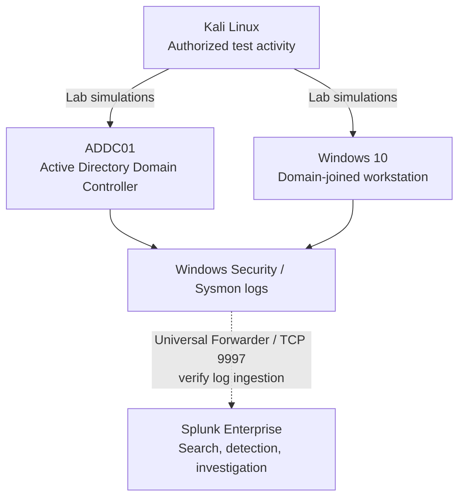

# Active Directory Detection Lab

> A hands-on SOC analyst home lab for collecting Windows security telemetry, detecting suspicious activity, and investigating events in Splunk.

## Project overview

This project simulates a small Windows enterprise environment using an Active Directory domain controller, a domain-joined Windows endpoint, a Kali Linux test machine, and a Splunk SIEM server. The purpose is to practice the full security operations workflow: **generate activity → collect telemetry → detect → investigate → document**.

The environment is built with VirtualBox on an EndeavourOS Linux host. It is an isolated, authorized home lab—not a production network.

**Current milestone:** Completed the installation and configuration steps through **Part 4** of MyDFIR's *Active Directory Project (Home Lab)* tutorial. Working on validating log ingestion, documenting the environment, and starting Part 5 detection exercises.

## Lab architecture



*The diagram shows the intended telemetry pipeline. End-to-end forwarding and relevant log sources still need to be verified before being marked complete.*

## Environment and network

| System | Operating system / role | IP address |
|---|---|---|
| Host | EndeavourOS; Oracle VirtualBox | Host networking |
| `ADDC01` | Windows Server; Active Directory Domain Services | `192.168.10.7` |
| `window10` | Windows 10; domain-joined workstation | DHCP / verify current address |
| `kali-linux-2025.4-virtualbox-amd64` | Kali Linux; authorized attack simulation | Verify current address |
| `splunk` | Ubuntu/Linux; Splunk Enterprise SIEM | `192.168.10.10` |

- **VirtualBox network:** NAT Network, `192.168.10.0/24`.
- **Windows domain DNS:** `192.168.10.7` (ADDC01).
- **Splunk Web:** `http://192.168.10.10:8000`.
- **Splunk receiving port:** TCP `9997` (to be verified).

These are the project's recorded settings; they should be checked against the restored VM configurations before being treated as tested facts.

## Project progress

- [x] Create the four VirtualBox machines and shared lab network.
- [x] Set up the Active Directory Domain Controller (`ADDC01`).
- [x] Set up the Windows 10 domain workstation.
- [x] Install Splunk Enterprise and prepare the SIEM host.
- [x] Follow MyDFIR Parts 1–4; restore the Part 4 checkpoints.
- [ ] Re-verify domain authentication, DNS, and network connectivity after restoring the checkpoints.
- [ ] Verify Windows event collection and Splunk Universal Forwarder connectivity on both Windows systems.
- [ ] Verify Sysmon telemetry and its availability in Splunk, if installed/configured.
- [ ] Run authorized simulations within the isolated lab (MyDFIR Part 5).
- [ ] Write detection searches and investigate the resulting events.
- [ ] Map confirmed techniques to MITRE ATT&CK and publish evidence-backed case studies.

## Planned detection scenarios

| Scenario | Example evidence to investigate |
|---|---|
| Failed logons / password guessing | Windows Security event `4625`; related domain authentication events, as applicable |
| Successful logon following failures | Windows Security event `4624` correlated with earlier failures |
| Account creation | Windows Security event `4720`, if auditing is enabled |
| Privileged group membership changes | Relevant Windows Security group-change events (for example, `4728` / `4732`) |
| Suspicious processes or PowerShell | Event `4688` and/or Sysmon process telemetry, if configured |

These are **planned use cases**, not detection results already achieved.

## Evidence and documentation

Screenshots from Parts 1–4 were not originally captured. They will be collected retrospectively from the **current verified lab configuration** and will not be represented as contemporaneous installation screenshots.

Suggested evidence:

1. VirtualBox Manager showing the four VMs.
2. VirtualBox NAT Network settings.
3. `ADDC01` IP/DNS configuration and Active Directory Users and Computers.
4. Windows 10 domain membership and IP/DNS configuration.
5. Splunk Web and host/index searches with actual results.
6. Windows Event Viewer / Sysmon operational logs, if present.
7. Part 5 simulation commands, resulting events, SPL searches, and investigations.

Suggested repository structure:

```text
Active-Directory-Detection-Lab/
├── README.md
├── docs/
│   ├── 01-lab-architecture.md
│   ├── 02-environment-setup.md
│   ├── 03-active-directory.md
│   ├── 04-log-collection.md
│   ├── 05-detection-investigations.md
│   └── lessons-learned.md
├── diagrams/
├── screenshots/
└── spl-queries/
```

## Investigation report format

For each completed exercise, record:

- **Objective and scope:** What behavior was simulated and on which authorized lab VM?
- **Data source:** Which machine, log/channel, and event IDs captured it?
- **Detection logic:** SPL query, time window, and why the result is suspicious.
- **Evidence:** Screenshots and relevant log fields (with timestamps).
- **Analysis:** Observed behavior versus the expected behavior; uncertainties and false-positive considerations.
- **MITRE ATT&CK mapping:** Only when the observed activity supports the technique.
- **Conclusion:** What a Tier 1 analyst should escalate, validate, or recommend next.

## Skills practiced

Active Directory, Windows authentication, Windows Event Logs, Splunk/SPL, Sysmon (pending verification), security telemetry collection, detection engineering, incident triage, and technical reporting.

## Learning reference and attribution

This home lab follows **MyDFIR's _Active Directory Project (Home Lab)_ YouTube series** for foundational setup. The screenshots, validation steps, detection experiments, analysis, and written case studies in this repository document my own work in my lab. Tutorial-derived procedures will be credited where used.

## Next milestone

Confirm that Windows 10 and ADDC01 produce security events that reach Splunk. Then run the first controlled Part 5 test and publish an investigation backed by logs, SPL queries, and screenshots.

> **Safety:** Run attack simulations only against lab systems you own or are authorized to test. Do not publish passwords, tokens, private keys, or other secrets in screenshots or logs.
