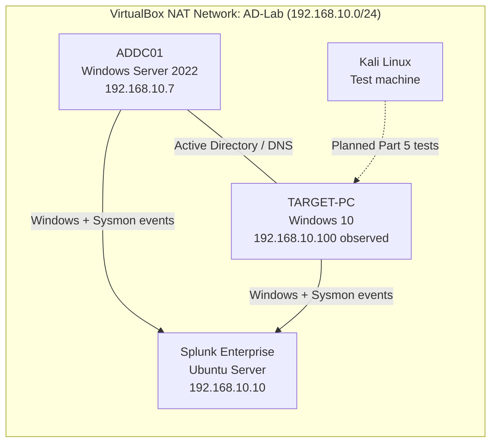
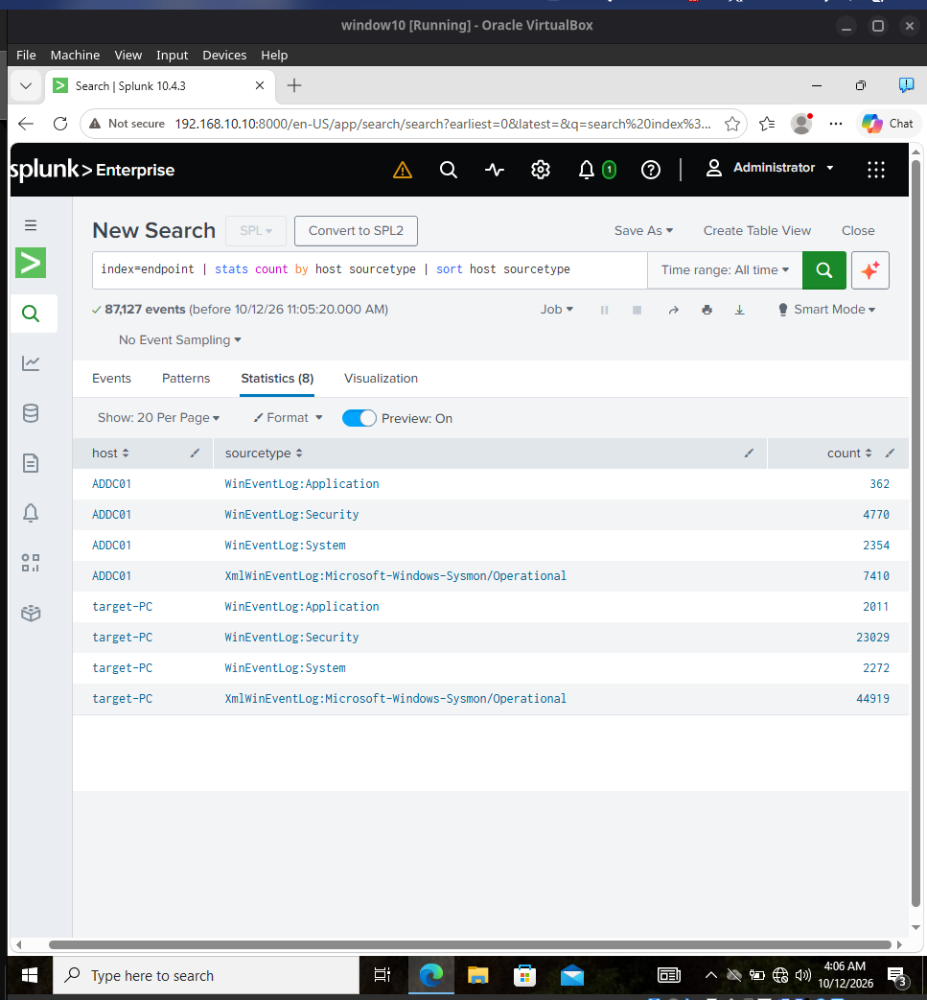
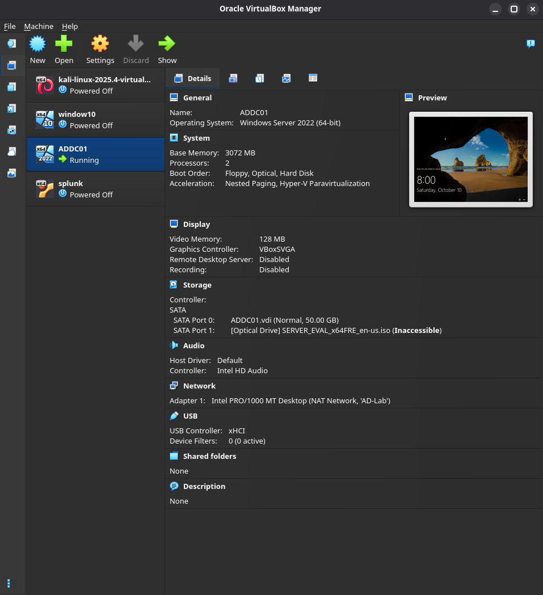
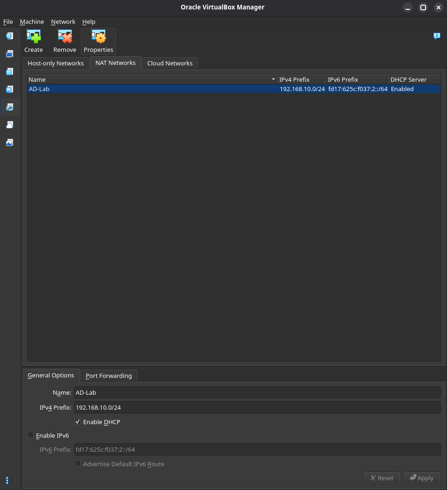
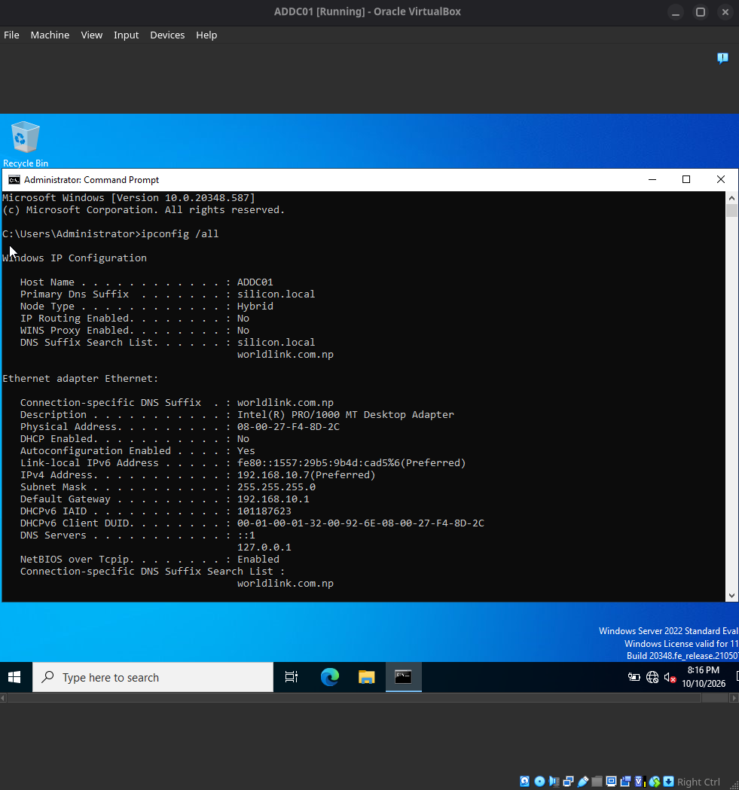
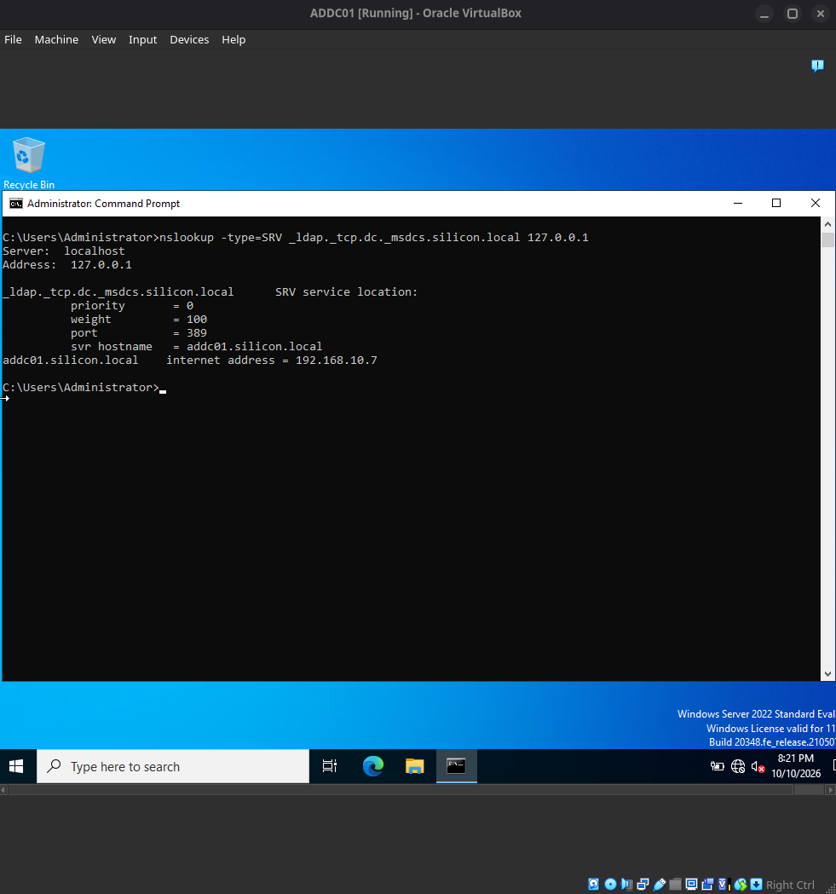
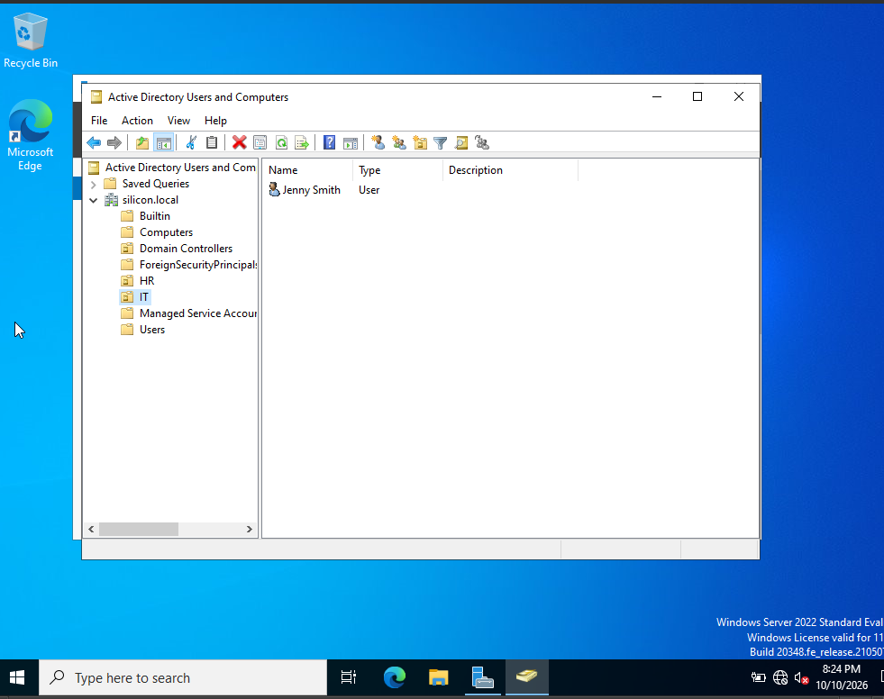
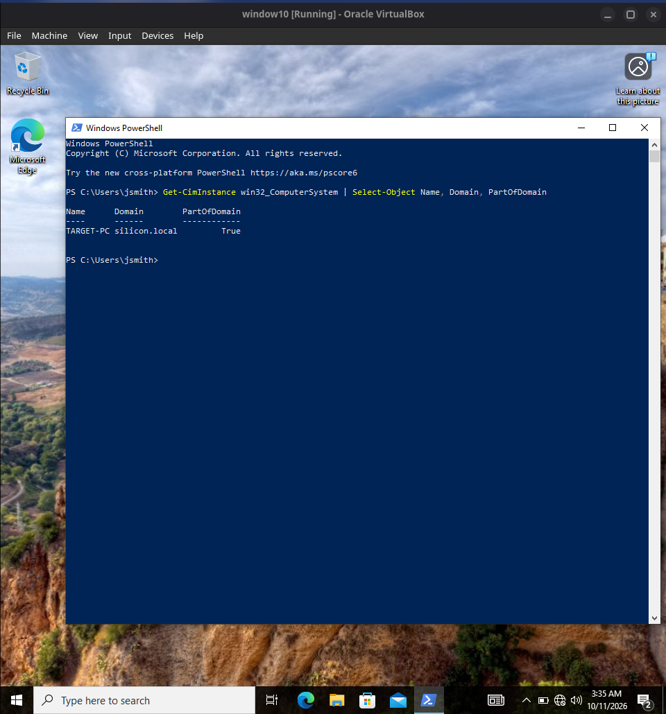

# Active Directory Detection Lab

A hands-on cybersecurity home lab built to practise how a SOC analyst collects Windows telemetry, investigates security events, and develops detections in Splunk.

**Current status:** MyDFIR's *Active Directory Project (Home Lab)* **Parts 1–4 completed and core setup verified**. Part 5 (attack simulation and detection) is next.

## Project overview

I built a small Windows domain environment in Oracle VirtualBox, with a Domain Controller, a domain-joined Windows 10 workstation, Kali Linux, and a Splunk Enterprise server. The aim is to learn the workflow a SOC analyst follows: **generate activity → collect logs → search → investigate → document findings**.

This repository documents my own lab configuration and the results I verified while following MyDFIR's tutorial. The environment is for authorised testing only, not a production network.

## Lab architecture



Splunk has indexed Windows and Sysmon events from **both** Windows systems. The dashed line from Kali represents **planned** simulation work, not a completed attack. The VirtualBox NAT Network is separate from the host's physical LAN but may still allow outbound internet access; it is not air-gapped.

## Environment and network

| Machine | Role | OS / software | IP address |
|---|---|---|---|
| Host | Virtualisation platform | EndeavourOS, Oracle VirtualBox | — |
| `ADDC01` | Domain Controller / DNS | Windows Server 2022, Active Directory Domain Services | `192.168.10.7` (static) |
| `TARGET-PC` (VirtualBox VM: `window10`) | Domain-joined endpoint | Windows 10 | `192.168.10.100` (observed) |
| `splunk` | SIEM / log analysis | Ubuntu Server, Splunk Enterprise 10.4.3 | `192.168.10.10` |
| Kali Linux | Authorised test machine for Part 5 | Kali Linux | To be verified before Part 5 |

**Verified lab settings:**

- VirtualBox NAT Network: `AD-Lab`, subnet `192.168.10.0/24`, DHCP enabled.
- Active Directory domain: `silicon.local`.
- ADDC01 gateway: `192.168.10.1`.
- ADDC01 uses local DNS (`127.0.0.1` / `::1`); an Active Directory DNS lookup resolved `addc01.silicon.local` to `192.168.10.7`.
- Splunk Web: `http://192.168.10.10:8000`.
- TCP `9997` is the planned Splunk forwarding port; its listener configuration has not been separately documented, although log ingestion is verified.

## What I completed (Parts 1–4)

### 1. Virtual machines and lab network

Created the four VirtualBox machines and configured them on the `AD-Lab` NAT Network. The separate lab subnet allows the Windows machines, Kali, and Splunk to communicate for testing and log collection.

**Verified:** Four VMs are registered in VirtualBox, and the NAT Network is configured with `192.168.10.0/24` and DHCP enabled.

### 2. Active Directory and Windows workstation

Configured `ADDC01` as the Domain Controller for `silicon.local`. Created organisational units to represent two departments:

| Organisational unit | Test account |
|---|---|
| `IT` | Jenny Smith |
| `HR` | Terry Smith |

Joined the Windows 10 workstation, `TARGET-PC`, to the domain. PowerShell returned `PartOfDomain : True`. I also verified that ADDC01's local DNS service resolves the domain controller's LDAP SRV record.

**Verified:** Domain structure, test users, domain membership, and DNS resolution. This does not by itself prove every authentication or Group Policy operation works.

### 3. Splunk and Windows security telemetry

Configured the Splunk environment and followed the Windows event-collection and Sysmon setup from MyDFIR's series. I then checked the indexed data using a **historical All time** search, rather than a real-time-only search.

```spl
index=endpoint
| stats count by host sourcetype
| sort host sourcetype
```

**Verification result (12 October 2026): 87,127 indexed events** across `ADDC01` and `target-PC` at the time of the search.

| Data source / sourcetype | ADDC01 | TARGET-PC |
|---|:---:|:---:|
| `WinEventLog:Application` | Yes | Yes |
| `WinEventLog:Security` | Yes | Yes |
| `WinEventLog:System` | Yes | Yes |
| `XmlWinEventLog:Microsoft-Windows-Sysmon/Operational` | Yes | Yes |

This confirms that historical Windows and Sysmon telemetry from **both hosts** is available in Splunk's `endpoint` index. The next step is to generate new security events and confirm they arrive and can be investigated during Part 5.



*Figure 7: Historical Splunk search showing Windows Application, Security, System and Sysmon logs from both ADDC01 and TARGET-PC (87,127 matched events).* 

## Setup evidence (Parts 1–4)

These screenshots were captured **after the initial setup**, to verify the current configuration. They are not presented as installation-time screenshots.

<details>
<summary><strong>Figures 1–2: VirtualBox environment and NAT Network</strong></summary>



*Figure 1: VirtualBox Manager showing the Kali Linux, Windows 10, ADDC01 and Splunk virtual machines.*



*Figure 2: `AD-Lab` NAT Network configured with `192.168.10.0/24` and DHCP enabled.*

</details>

<details>
<summary><strong>Figures 3–4: Domain Controller networking and DNS</strong></summary>



*Figure 3: ADDC01 network configuration, including static address `192.168.10.7`, gateway and DNS settings.*



*Figure 4: LDAP SRV lookup successfully identifying `addc01.silicon.local` at `192.168.10.7` on port `389`.*

</details>

<details>
<summary><strong>Figures 5a–5b: Active Directory users and organisational units</strong></summary>



*Figure 5a: IT organisational unit with the Jenny Smith test account.*


*Figure 5b: HR organisational unit with the Terry Smith test account.*

</details>

<details>
<summary><strong>Figure 6: Windows 10 domain membership</strong></summary>



*Figure 6: PowerShell verification showing `TARGET-PC` joined to `silicon.local` (`PartOfDomain = True`).*

</details>

## Current progress

- [x] Create and configure the four VirtualBox lab machines.
- [x] Configure the `AD-Lab` NAT Network.
- [x] Configure `ADDC01` and verify Active Directory DNS resolution.
- [x] Create HR and IT organisational units and test users.
- [x] Join `TARGET-PC` to `silicon.local`.
- [x] Install and access Splunk Enterprise.
- [x] Verify historical Windows Security, Application, System and Sysmon events in Splunk for both Windows machines.
- [ ] Verify fresh event delivery during a controlled test.
- [ ] Confirm Kali's current IP configuration before the first Part 5 simulation.
- [ ] Complete MyDFIR Part 5 attack simulations.
- [ ] Write SPL detections and publish evidence-backed investigations.

## Next: Part 5 — Attack simulation and detection

The next stage is to use **Kali Linux and authorised test activity** to generate security events, then analyse them in Splunk. MyDFIR Part 5 also introduces Atomic Red Team.

For each exercise, I plan to document:

1. **Objective and scope** — What was tested, and on which lab system.
2. **Evidence** — Event IDs, accounts, timestamps, source details and screenshots.
3. **Detection** — SPL query, time window and reason for investigating the result.
4. **Analysis** — What the events show, what remains uncertain and possible false positives.
5. **Outcome** — Findings, next steps and MITRE ATT&CK mapping where supported by the evidence.

Planned investigation topics include failed logons (`4625`), successful logons (`4624`), changes to accounts or privileged groups, and suspicious process activity using Windows Security logs and Sysmon. **These are planned exercises, not completed detections.**

## Issues encountered and lessons learned

- **Splunk Web access:** Both Windows machines initially displayed an XML `Connection refused` response. Tests showed TCP connectivity to port `8000`, and the Splunk server was listening on ports `8000` and `8089`. Splunk Web access was later restored; I did not record the exact final fix, so I am not claiming a specific root cause.
- **VM storage:** The dedicated VM partition filled up during the project. I recovered usable space and moved the Kali VM to a different host partition using VirtualBox's Move feature without reinstalling Kali.
- **Verification:** I learned to distinguish a successful network connection from a working application, and a few visible events from a verified historical logging pipeline.

## Repository organisation

- `README.md` — Lab overview, implementation status and evidence.
- `screenshots/` — Verified screenshots from Parts 1–4.
- `diagrams/` — Diagram assets; the current architecture is also shown above in Mermaid.
- **Planned:** Separate `docs/` and detection-query files for Part 5 investigation reports.

## Learning reference and attribution

This project follows [MyDFIR's *Active Directory Project (Home Lab)* series](https://www.youtube.com/@MyDFIR) for the foundational build, particularly [Part 4](https://www.youtube.com/watch?v=1XeDht_B-bA) and [Part 5](https://www.youtube.com/watch?v=orq-OPIdV9M). Credit for the tutorial structure and procedures belongs to MyDFIR. The configuration checks, screenshots and findings here are from my own lab.

**Safety:** All simulated activity is restricted to lab systems I own or am authorised to test. No real user credentials, secrets, or production systems are used in this project.
