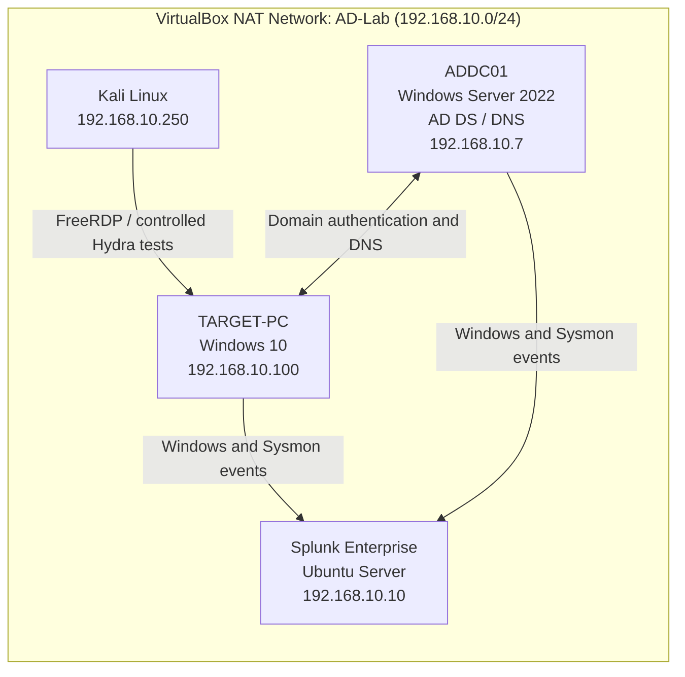
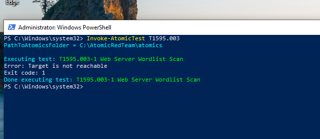
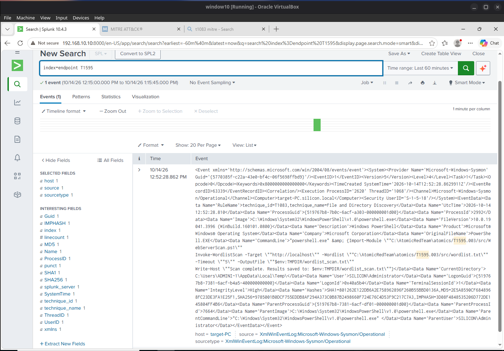
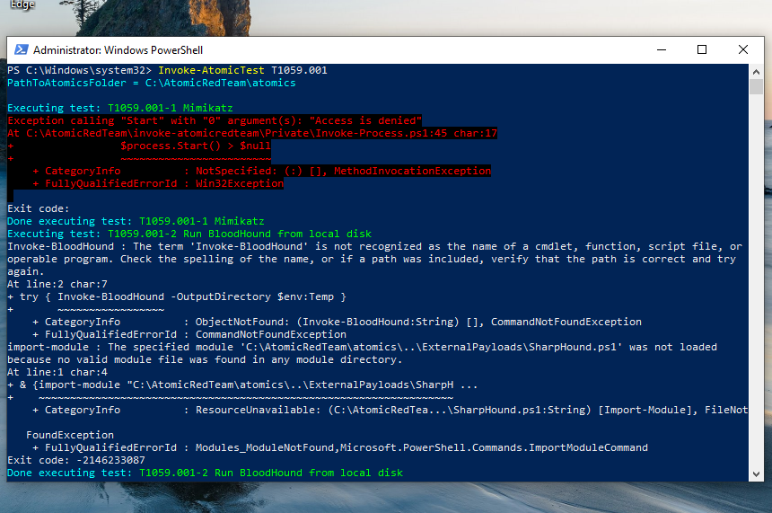
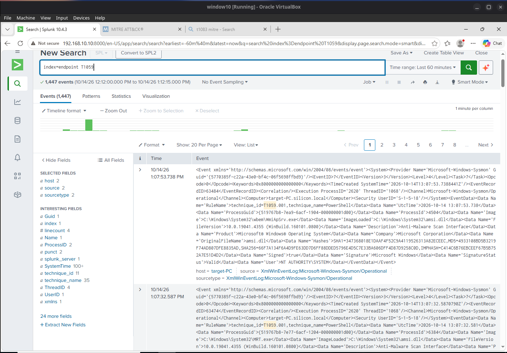
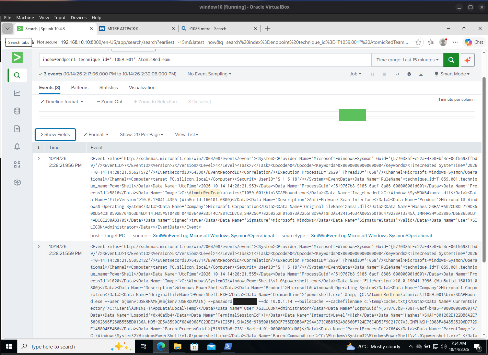

# Active Directory Detection Lab

**Active Directory · Windows Security Events · Sysmon · Splunk Enterprise · Kali Linux · Atomic Red Team**

A four-machine cybersecurity home lab built to practise the workflow of a Security Operations Centre (SOC) analyst: **generate activity, collect evidence, investigate the logs, and explain the findings**.

**Project status:** Completed all five parts of MyDFIR's *Active Directory Project (Home Lab)* walkthrough. The lab setup, RDP password-guessing exercise, and Atomic Red Team-related telemetry are documented below. Some Atomic tests failed to achieve their intended objectives; those outcomes are recorded rather than treated as successful attacks.

> **Scope:** This is an isolated *testing environment* on a VirtualBox NAT Network, not a production deployment or an air-gapped network. All simulated activity was performed against lab systems under my control.

## Project results

| Area | What I verified |
|---|---|
| Active Directory | Configured the `silicon.local` domain, DNS, organisational units and test users on Windows Server 2022 |
| Domain workstation | Joined `TARGET-PC` to the domain and authenticated with a domain account |
| Central log collection | Windows Security, Application, System and Sysmon events from both Windows VMs appeared in Splunk's `endpoint` index |
| Initial telemetry check | **87,127 indexed events** in a historical Splunk search on 12 October 2026 (a snapshot, not a daily rate) |
| RDP authentication | Confirmed a successful FreeRDP session from Kali to `TARGET-PC` as `SILICON\tsmith` |
| Controlled password guessing | Hydra reported **one valid lab credential** from a 22-candidate password list |
| RDP investigation | A Splunk search showed **18 Event ID 4625** failure matches; a separate search showed **one Event ID 4624** success match from Kali |
| Atomic Red Team | Captured a `T1595.003`-related PowerShell process (Sysmon Event ID 1) and `T1059.001`-labelled image-load activity (Sysmon Event ID 7) |

**Tools used:** Oracle VirtualBox, Windows Server 2022, Windows 10, Active Directory Domain Services (AD DS), Kali Linux, FreeRDP, Hydra, Splunk Enterprise, Sysmon, Splunk Universal Forwarder, PowerShell and Atomic Red Team.

**SOC case studies:** [RDP Password-Guessing Investigation](docs/rdp-authentication-investigation.md) · [Atomic Red Team Telemetry Investigation](docs/atomic-red-team.md)

## 1. Lab architecture



| System | Purpose | IP address |
|---|---|---|
| `ADDC01` | Domain Controller, AD DS and DNS | `192.168.10.7` |
| `TARGET-PC` | Domain-joined Windows 10 endpoint, logging and simulation | `192.168.10.100` |
| `kali` | Authorised security test machine | `192.168.10.250` |
| `splunk` | Centralised event ingestion and investigation | `192.168.10.10` |

**Host operating system:** EndeavourOS. **Lab domain:** `silicon.local`. **Virtual network:** `AD-Lab`, `192.168.10.0/24`, DHCP enabled. **Splunk Web:** `http://192.168.10.10:8000` (lab address).

## 2. Building the environment — Parts 1–4

### Part 1 — Virtual machines and networking

Created the four virtual machines and connected them to the same VirtualBox NAT Network. Verified the subnet and DHCP configuration before configuring the servers and endpoints.


*Figure 1 — The four VirtualBox lab machines.*


*Figure 2 — NAT Network `AD-Lab` on `192.168.10.0/24`.*

### Part 2 — Active Directory and DNS

Configured `ADDC01` as the Domain Controller for `silicon.local`. Organised lab users into department-based OUs:

| Organisational unit | Test user | Username |
|---|---|---|
| `IT` | Jenny Smith | `jsmith` |
| `HR` | Terry Smith | `tsmith` |

Verified domain DNS discovery by resolving the LDAP service record for `silicon.local`, which identified `addc01.silicon.local` at `192.168.10.7`.

<details>
<summary>View Active Directory and DNS evidence (Figures 3–5b)</summary>


*Figure 3 — ADDC01 IP and DNS configuration.*


*Figure 4 — LDAP SRV lookup identifying the Domain Controller.*


*Figure 5a — IT OU and the `jsmith` test account.*


*Figure 5b — HR OU and the `tsmith` test account.*

</details>

### Part 3 — Windows workstation domain join

Joined `TARGET-PC` to `silicon.local` and verified that Windows reported `PartOfDomain = True`. Later confirmed an interactive domain login through RDP using `SILICON\tsmith`.


*Figure 6 — Windows 10 domain membership verification.*

### Part 4 — Splunk and Sysmon telemetry

Configured Windows event forwarding to Splunk and verified that both `ADDC01` and `TARGET-PC` had events in the `endpoint` index. The indexed data included:

- `WinEventLog:Security`
- `WinEventLog:Application`
- `WinEventLog:System`
- `XmlWinEventLog:Microsoft-Windows-Sysmon/Operational`

**Verification query:**

```spl
index=endpoint
| stats count by host sourcetype
| sort host sourcetype
```

The historical search showed **87,127 matching events** on 12 October 2026. Later Part 5 tests also produced events visible in Splunk, demonstrating fresh telemetry delivery.


*Figure 7 — Historical Windows and Sysmon events indexed for both hosts.*

## 3. Security testing and investigation — Part 5

### 3.1 Establishing an RDP baseline

Before simulating password guessing, I connected from Kali to `TARGET-PC` using FreeRDP and the lab account `SILICON\tsmith`. In the remote Windows session, `whoami`, `hostname`, and `ipconfig` confirmed the authenticated user and destination workstation.


*Figure 8 — Kali FreeRDP session; Windows reports `silicon\tsmith`, `target-PC` and `192.168.10.100`.*

**Why this mattered:** It established that the RDP service, Active Directory account and domain authentication worked before the password-guessing test.

### 3.2 Controlled RDP password guessing with Hydra

I used Hydra on Kali to test RDP authentication against the Windows workstation. The test used a lab password file containing **22 candidate entries** and targeted the `tsmith` domain account. Hydra v9.7 reported **one valid credential found** and one target successfully completed. The credential is redacted from the evidence image.

**Relevant MITRE ATT&CK mapping:** [T1110.001 — Password Guessing](https://attack.mitre.org/techniques/T1110/001/). This mapping describes the simulated behaviour; it is not a claim that an intrusion occurred outside the lab.


*Figure 9 — Controlled Hydra RDP test reporting one valid lab credential; the password has been redacted.*

### 3.3 Investigating failed and successful logons in Splunk

I searched Windows Security logs collected from `TARGET-PC` and filtered on activity associated with Kali (`192.168.10.250`).

**Failed-logon query:**

```spl
index=endpoint EventCode=4625 kali
```

The search returned **18 matching failed-logon events** in the displayed 15-minute window. The event details identified Kali as the workstation and `192.168.10.250` as the source IP.


*Figure 10 — Eighteen Windows Security Event ID 4625 matches associated with Kali.*

**Successful-logon query:**

```spl
index=endpoint EventCode=4624 kali
```

A separate search returned **one matching successful-logon event** in its displayed 15-minute window, again associated with Kali.


*Figure 11 — Windows Security Event ID 4624 associated with the Kali source.*

**Interpretation:** The Hydra result and Windows logs provide evidence of controlled password-guessing activity and both failed and successful authentication. Earlier manually verified events also showed successful RDP **Logon Type 10** and failed network authentication **Logon Type 3** with substatus `0xC000006A` (incorrect password). The 18 failures and one success are **Splunk event counts**, not a claim that all 22 configured passwords were attempted or that every event maps one-to-one to a candidate.

**Investigation query:**

```spl
index=endpoint host="target-PC" (EventCode=4624 OR EventCode=4625) "192.168.10.250"
| table _time host EventCode Message
| sort -_time
```

### 3.4 Atomic Red Team — T1595.003 Wordlist Scanning

Used Atomic Red Team to attempt **T1595.003 (Wordlist Scanning)** on `TARGET-PC`. The PowerShell test returned **`Target is not reachable`** (exit code `1`), so I do **not** claim that a completed web scan occurred.



*Figure 12 — The wordlist-scanning test was attempted but reported an unreachable target.*

I then searched Splunk for the test activity and found a **Sysmon Event ID 1 (Process Creation)** referencing the PowerShell command and the `T1595.003` Atomic Red Team path. The process-creation event proves the associated command was observed; it does not establish a successful scan. The event's Sysmon `RuleName` mentions `T1083`, which is a rule label and should not be confused with the Atomic test ID.



*Figure 13 — Sysmon process telemetry for the Atomic T1595.003 attempt, collected in Splunk.*

### 3.5 Atomic Red Team — T1059.001 PowerShell

I also attempted Atomic tests associated with **T1059.001 (PowerShell)**. Some test steps returned errors, including an access-denied result and missing BloodHound-related commands or modules. These results were retained as troubleshooting evidence, **not reported as successful technique execution**.



*Figure 14 — PowerShell execution attempts and errors during Atomic Red Team testing.*

A broad Splunk search for `T1059` returned **1,447 matching events** in the selected window. That is a search-result count, **not** a count of attacks or successful tests.



*Figure 15 — Broad T1059-related search results in Splunk.*

A narrower search using the technique label `T1059.001` and `AtomicRedTeam` returned **three matching events**. The visible event contents included **Sysmon Event ID 7 (Image Loaded)** activity involving `amsi.dll`. This demonstrates detection visibility for associated activity; it does not independently establish that the intended Atomic technique completed successfully. A command-line password in the screenshot has been redacted.



*Figure 16 — Three focused matches for T1059.001-related activity in Sysmon; sensitive command-line data redacted.*

### 3.6 Detailed SOC investigation reports

I wrote two evidence-based case studies to show the investigation process beyond the screenshots in this README:

| Investigation | What I analysed | Read the report |
|---|---|---|
| **RDP password guessing** | Hydra test results; Windows Security Events `4625` (failed logons) and `4624` (successful logon); source attribution and investigative limitations | [Case Study 01 — RDP Authentication Investigation](docs/rdp-authentication-investigation.md) |
| **Atomic Red Team telemetry** | `T1595.003` and `T1059.001` test output; Sysmon process creation and image-load events; execution errors and detection limitations | [Case Study 02 — Atomic Red Team Investigation](docs/atomic-red-team.md) |

Both reports distinguish **what was observed in Splunk** from **whether the simulated technique succeeded**. The SPL searches in the reports were used for manual investigation, not represented as deployed automatic alerts.

## 4. What the evidence shows — and what it does not

| Verified finding | Important limit |
|---|---|
| Both Windows hosts delivered events to Splunk | A historical event total is not a performance or availability guarantee |
| Kali opened an authenticated FreeRDP session | This is authorised testing, not evidence of unauthorised access |
| Hydra reported one valid credential | A 22-entry candidate list does not prove 22 authentication attempts were processed |
| Windows recorded 4625 failures and a 4624 success | The screenshots do not establish a one-to-one match between every Hydra attempt and Windows event |
| Splunk recorded the T1595.003 PowerShell process | The scan itself reported its target unreachable |
| Splunk recorded T1059.001-related Sysmon image loads | Image-load events alone do not establish completion of the Atomic test |

I used Splunk **searches and manual investigation**, rather than claiming to have deployed or validated an automated brute-force detection alert.

## 5. Troubleshooting and lessons learned

- **Domain DNS dependency:** `TARGET-PC` could reach `8.8.8.8` but could not resolve GitHub because its DNS server (`ADDC01`, `192.168.10.7`) was powered off. Booting ADDC01 restored domain-name resolution.
- **Authentication tool behaviour:** Earlier Crowbar, Ncrack and Hydra tests did not produce a confirmed valid-password result. Manual FreeRDP authentication worked, and a later Hydra run succeeded. Separating tool errors from Windows authentication failures avoided unnecessary changes to Active Directory.
- **Evidence validation:** Windows Security Event IDs `4624` and `4625` provided the account, source and authentication outcome. Sysmon supplied process and image-load context for Atomic Red Team attempts.
- **Atomic test prerequisites:** Missing dependencies or an unreachable target can prevent an Atomic test from completing even when the process is visible in the logs.
- **Virtual machine storage:** Recovered space on a full VM storage partition and relocated the Kali virtual disk using VirtualBox without reinstalling the guest.

## 6. Screenshot index

All images below are from the lab. Screenshots 1–7 verify the setup; screenshots 8–16 document Part 5 tests and observed events.

| Figure | Evidence |
|---|---|
| 01 | [VirtualBox machines](screenshots/01-virtualbox-overview.png) |
| 02 | [VirtualBox NAT Network](screenshots/02-nat-network.png) |
| 03 | [ADDC01 network configuration](screenshots/03-addc01-network.png) |
| 04 | [Active Directory DNS verification](screenshots/04-ad-dns-verification.png) |
| 05a / 05b | [IT OU](screenshots/05a-ad-it-users.png) / [HR OU](screenshots/05b-ad-hr-users.png) |
| 06 | [Windows 10 domain join](screenshots/06-windows10-domain-join.png) |
| 07 | [Splunk log ingestion](screenshots/07-splunk-log-ingestion.png) |
| 08 | [Kali RDP session](screenshots/08-kali-rdp-session.png) |
| 09 | [Hydra result, redacted](screenshots/09-hydra-rdp-password-guessing.png) |
| 10 | [Splunk failed logons, 4625](screenshots/10-splunk-rdp-failed-logons.png) |
| 11 | [Splunk successful logon, 4624](screenshots/11-splunk-rdp-successful-logon.png) |
| 12 | [Atomic T1595.003 test output](screenshots/12-atomic-t1595-wordlist-test.png) |
| 13 | [T1595.003 Sysmon process evidence](screenshots/13-atomic-t1595-sysmon-detection.png) |
| 14 | [Atomic T1059.001 test output](screenshots/14-atomic-t1059-powershell-test.png) |
| 15 | [Broad T1059 Splunk results](screenshots/15-atomic-t1059-splunk-events.png) |
| 16 | [Focused T1059.001 Sysmon evidence, redacted](screenshots/16-atomic-t1059-001-detection.png) |

## 7. Attribution and responsible use

This project follows the learning structure of [MyDFIR's *Active Directory Project (Home Lab)* video series](https://www.youtube.com/@MyDFIR), especially [Part 4](https://www.youtube.com/watch?v=1XeDht_B-bA) and [Part 5](https://www.youtube.com/watch?v=orq-OPIdV9M). Credit for the walkthrough belongs to MyDFIR; the configuration checks, troubleshooting, screenshots and findings here describe my own lab work.

Testing was limited to machines in the authorised VirtualBox environment. No production systems or third-party targets were tested, and real passwords or private keys are not published.
