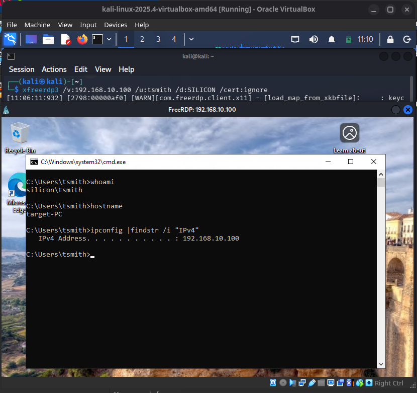
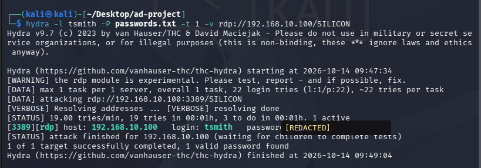
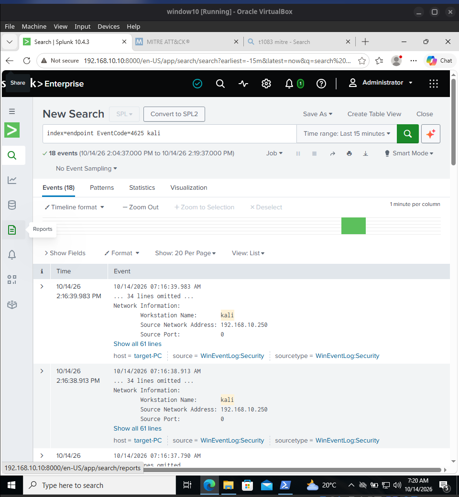
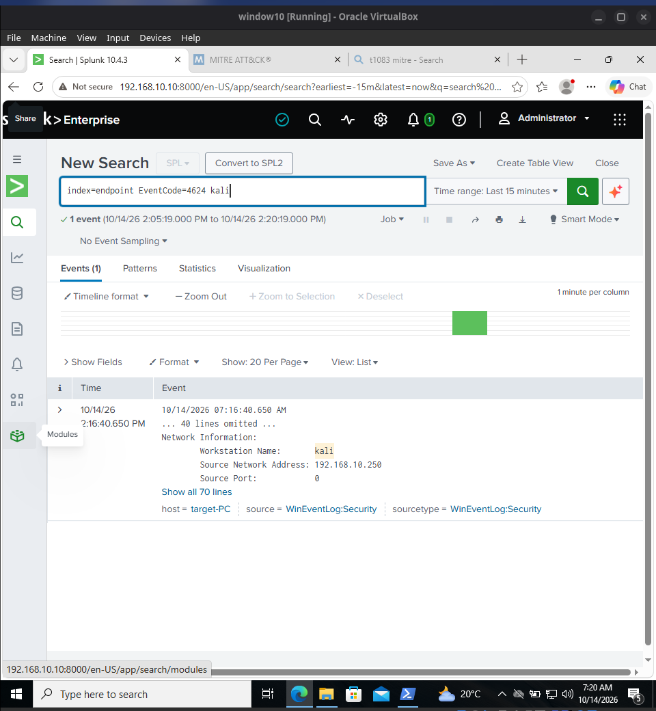

# Case Study 01 — RDP Password Guessing and Windows Logon Investigation

**Date:** 14 October 2026  
**Environment:** Authorised Active Directory home lab (`silicon.local`)  
**Source:** Kali Linux (`192.168.10.250`)  
**Destination:** `TARGET-PC`, Windows 10 (`192.168.10.100`)  
**Account:** `SILICON\tsmith` — lab test account  
**Data source:** Windows Security events in Splunk Enterprise, `index=endpoint`  
**MITRE ATT&CK:** [T1110.001 — Brute Force: Password Guessing](https://attack.mitre.org/techniques/T1110/001/)

## Objective

Simulate RDP password guessing in a controlled environment, identify the associated Windows logon events in Splunk, and distinguish observed evidence from assumptions about the number of attempts or the attack's outcome.

## 1. Confirm the RDP baseline

Before testing, I confirmed that the test account was enabled and not locked in Active Directory, that it belonged to the workstation's **Remote Desktop Users** group, and that the RDP service was reachable from Kali.

I then connected from Kali using FreeRDP. Inside the remote Windows session, these commands verified the authenticated account and destination:

```cmd
whoami
hostname
ipconfig | findstr /i "IPv4"
```

Observed output identified `silicon\tsmith` on `target-PC`, address `192.168.10.100`.



*Figure 8 — Successful FreeRDP connection from Kali, with the domain user, hostname and destination IP visible.*

This check mattered because an RDP connection failure can otherwise be mistaken for a rejected password.

## 2. Generate controlled authentication activity

On Kali Linux, I used **Hydra v9.7** against the lab workstation's RDP service. The test was limited to one account and one Hydra connection task, with a list containing **22 candidate passwords**. A later run reported:

```text
[DATA] max 1 task per 1 server, overall 1 task, 22 login tries (l:1/p:22)
[3389][rdp] host: 192.168.10.100  login: tsmith  password: [REDACTED]
1 of 1 target successfully completed, 1 valid password found
```



*Figure 9 — Hydra reports one valid lab credential. The password is redacted before publication.*

**Interpretation:** Hydra identified one valid credential. The 22 entries describe the configured candidate list; they are **not** a verified count of Windows authentication failures.

## 3. Investigate Windows authentication events in Splunk

I searched the `endpoint` index for Windows Security events referencing Kali in the same investigation period.

### Failed logons — Event ID 4625

```spl
index=endpoint EventCode=4625 kali
```

The screenshot shows **18 matching events** during the selected **15-minute** search window. A visible record is from `target-PC` and includes the Kali workstation and source address `192.168.10.250`.



*Figure 10 — Splunk returns 18 Event ID 4625 matches associated with the Kali source.*

### Successful logon — Event ID 4624

```spl
index=endpoint EventCode=4624 kali
```

A separate **15-minute** search returned **one matching successful-logon event** recorded on `target-PC`, again showing Kali (`192.168.10.250`) as its source.



*Figure 11 — Splunk returns a successful Event ID 4624 associated with Kali.*

The visible failure and success entries appear close together in the Splunk screenshots. Combined with Hydra's successful result, this is **consistent with password guessing followed by valid authentication**. It is not a complete, per-password reconstruction of Hydra's activity.

### What the logon types tell us

During an earlier manual RDP baseline test on **13 October 2026**, I also examined the event details:

| Windows event | Logon type | Meaning in this lab |
|---|---:|---|
| `4624` | `3` | Successful network authentication (including the RDP/NLA phase) |
| `4624` | `10` | Successful RemoteInteractive/RDP session |
| `4625` | `3` | Failed network authentication before a remote desktop session was established |

The earlier failed records showed `0xC000006D` (logon failure) with substatus `0xC000006A` (incorrect password). These detailed logon-type and status observations are **from the earlier manual tests**, not fields independently established for every 14 October Hydra event.

## 4. Reusable investigation queries

View successful and unsuccessful authentication associated with Kali:

```spl
index=endpoint host="target-PC" (EventCode=4624 OR EventCode=4625) "192.168.10.250"
| eval result=case(EventCode=4624,"Successful",EventCode=4625,"Failed")
| table _time host EventCode result Message
| sort -_time
```

Count the two event types within a selected time window:

```spl
index=endpoint host="target-PC" (EventCode=4624 OR EventCode=4625) "192.168.10.250"
| stats count by EventCode
```

These are **investigation searches**, not deployed or production-validated alert rules. For a future alert, I would test a failure threshold and a failure-then-success correlation grouped by source IP and account, then review false positives.

## 5. Analyst assessment

| Area | Finding |
|---|---|
| Activity | Controlled RDP password-guessing exercise from Kali against one domain test account |
| Tool result | Hydra reported one valid credential |
| Windows telemetry | 18 failed-logon matches and one successful-logon match in the screenshots' selected windows |
| Detection value | Windows Security events provide outcome, source, account and logon context for triage |
| ATT&CK mapping | T1110.001 — Password Guessing, based on the simulated behaviour |

**Limitations:** The screenshots do not prove that all 22 candidate entries were attempted, that every entry produced exactly one Windows event, or that an automatic Splunk alert fired. Ordinary password mistakes, stale credentials and service retries can also produce Event ID 4625; the source, timing and accompanying success provide the investigative context.

## 6. Troubleshooting and lessons learned

Earlier Crowbar, Ncrack and Hydra tests did not consistently recognise the valid credential. One Hydra attempt stopped with `freerdp: Timeout waiting for activation (0x0002001c)`. Manual FreeRDP authentication and Windows/Splunk evidence helped separate tool errors from RDP or Active Directory failures. A later Hydra run completed and reported a valid credential; the exact root cause of the earlier timeout was **not established**.

**Takeaway:** A SOC investigation should connect tool output to endpoint telemetry and describe exactly what the evidence supports—without treating every search match as a confirmed attack or every connection error as a rejected password.
